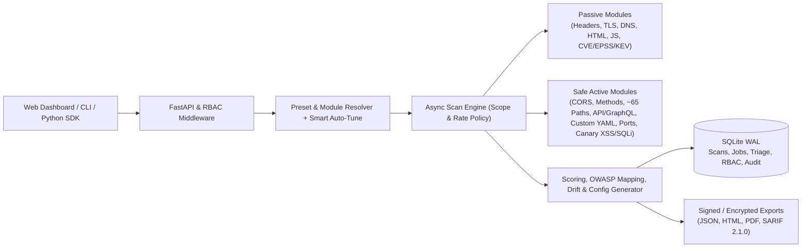

<div align="center">

# 🛡️ VulnScanner v3.1

**Modular, Non-Destructive Web Security & Posture Assessment Platform**

[](#quick-start)
[](#rest-api-reference)
[](#reporting--cryptographic-verification)
[](LICENSE)

*FastAPI Backend · Interactive Tailwind Dashboard (EN/TR, Dark/Light) · Granular 19-Module Selector · Smart Auto-Tune · CLI · Python SDK · Docker*

</div>

---

> [!IMPORTANT]
> **Ethical & Legal Use Only:** VulnScanner is a defensive security auditing and remediation verification tool. Scan **only** systems you own or have explicit written permission to test. Every scan enforces scope boundaries, optional time windows, and full audit logging.

---

## ✨ Highlights

- **🤖 Smart Auto-Tune (`auto_tune`)** — Sends a single lightweight preflight request to detect WAF/CDN presence, response latency, HTTPS support, `Content-Type` (HTML vs. JSON API), and versioned `Server` headers, then automatically configures the safest speed profile and modules.
- **🧩 Granular 19-Module Selection** — Pick and combine individual **Passive** (`headers`, `tech`, `html`, `tls`, `dns`, `js`, `cve`) and **Active** (`cors`, `methods`, `errors`, `files`, `dirs`, `api`, `custom`, `ports`, `ratelimit`, `crawl`, `xss_sqli`, `redirect`) modules from the Web UI, CLI, REST API, or Python SDK.
- **⚡ 7 Ready-to-Use Scan Presets** — One-click modes for *Smart Auto-Tune*, *Quick Passive Check*, *Production Safe (WAF-Friendly)*, *Full Deep Audit*, *API & Microservice Check*, *TLS & DNS/Mail*, and *24h Continuous Monitoring*.
- **🔧 Automated Remediation & Server Config Generator** — Every finding includes CWE + OWASP Top 10:2021 mapping, risk explanation, and step-by-step fix guidance, plus auto-generated copy-paste hardening configs for **nginx**, **Apache**, and **IIS (`web.config`)**.
- **✓ One-Click Fix Verification (`/api/recheck`)** — Re-runs *only* the relevant check module for a single finding in seconds and automatically marks it `fixed` once resolved.
- **📈 Drift Detection, Score Trends & Asset Inventory** — Tracks changes between scans (newly opened/closed TCP ports, removed security headers, replaced TLS certificates, software version changes), plots SVG score trends, and maintains a cross-target inventory.
- **📄 Signed & Encrypted Multi-Format Reports** — Export reports in **JSON**, **HTML**, **PDF**, and **SARIF 2.1.0** (GitHub Code Scanning compatible), signed with **HMAC-SHA256 (`X-Report-Signature`)** and optionally encrypted with **PBKDF2 + AES/Fernet**.
- **🔐 Enterprise Governance** — Role-Based Access Control (`admin`, `analyst`, `viewer`), `X-API-Key` management, HMAC-signed authorisation documents (`/api/authorisations`), persistent SQLite job recovery, Prometheus `/metrics`, and 1-click **GitHub / GitLab / Jira** issue creation.

---

## 🏗️ Architecture



---

## 🚀 Quick Start

### 1. Local Installation (Windows / Linux / macOS)

```bash
# Clone the repository
git clone https://github.com/your-username/vulnscanner.git
cd vulnscanner

# Create and activate a virtual environment
python -m venv .venv
# Windows (PowerShell):
.venv\Scripts\Activate.ps1
# Linux / macOS:
source .venv/bin/activate

# Install dependencies
pip install -r requirements.txt

# Start the server
uvicorn app.main:app --host 127.0.0.1 --port 8000
```

> On Windows, you can also double-click **`start.bat`** to launch the server and open `http://127.0.0.1:8000` automatically.

### 2. Docker & Docker Compose

```bash
docker compose up --build -d
```

Then open **`http://127.0.0.1:8000`** in your browser.

---

## ⚡ Ready-to-Use Scan Presets

| Preset ID | Mode | Default Profile | Modules | Description |
| :--- | :--- | :---: | :---: | :--- |
| `auto` | **🤖 Smart Auto-Tune** | Auto (`gentle`/`normal`) | Dynamic | Probes the target first and automatically adjusts speed, WAF safety, TLS, API, and CVE modules. |
| `quick_passive` | **⚡ Quick Passive Check** | `fast` | 6 | Headers, cookies, TLS, DNS/mail, and HTML/JS analysis only. Zero active parameter or port probing. |
| `production_safe` | **🛡️ Production Safe** | `gentle` (2 req/s) | 18 | WAF-friendly rate limit, no burst probing, shallow crawl. Safe for live production sites. |
| `full_audit` | **🔍 Full Deep Audit** | `normal` | 19 | All passive and safe active checks + CVE/EPSS/KEV/OSV + RDAP domain expiry + custom rules. |
| `api_security` | **🔌 API & Microservice** | `normal` | 10 | Focuses on CORS, HTTP methods, JWT, GraphQL, OpenAPI/Swagger, rate limiting, and parameter checks. |
| `tls_dns` | **🔐 TLS & DNS/Mail** | `fast` | 3 | Certificate validity/strength, TLS 1.0–1.3, HSTS, HTTPS redirect, SPF, DMARC, DKIM, CAA, takeover. |
| `continuous_monitor` | **⏱️ 24h Monitoring** | `gentle` | 18 | Gentle scan repeated every 24 hours with notifications and port/header/certificate drift detection. |

---

## 🧩 Selectable Scan Modules (19 Modules)

You can enable or disable any combination of modules in the Web UI, CLI (`--modules`), REST API (`"modules": [...]`), or Python SDK:

| Module ID | Group | What It Checks |
| :--- | :---: | :--- |
| `headers` | 🟢 Passive | CSP, HSTS, X-Frame-Options, `nosniff`, Referrer/Permissions-Policy, `Cache-Control`, cookie flags, session entropy, HTTP/2 & HTTP/3 (`Alt-Svc`) |
| `tech` | 🟢 Passive | Web server, framework, CMS, and CDN/WAF fingerprinting from headers, cookies, and HTML |
| `html` | 🟢 Passive | Forms & CSRF tokens, missing SRI on external scripts, mixed content, HTML comments, JWT weaknesses (`alg:none`, missing `exp`), passive cloud buckets (S3/GCS/Azure) |
| `tls` | 🟢 Passive | Certificate validity & days remaining, RSA/ECDSA key size, weak signature hashes, TLS 1.0/1.1/1.2/1.3 support, HTTP→HTTPS redirect |
| `dns` | 🟢 Passive | SPF, DMARC, DKIM (common selectors), CAA records, dangling CNAME subdomain takeover, optional RDAP domain expiration |
| `js` | 🟢 Passive | Leaked API keys/tokens (masked in reports), discovered API paths, and outdated JS libraries (jQuery, AngularJS, Bootstrap, Lodash, Moment.js) |
| `cve` | 🟢 Passive | NVD CVE lookup enriched with **FIRST.org EPSS** exploit probability and **CISA KEV** active exploitation status |
| `cors` | 🟠 Active | Arbitrary origin reflection and unsafe `Access-Control-Allow-Credentials: true` combinations |
| `methods` | 🟠 Active | Dangerous enabled HTTP methods (`PUT`, `DELETE`, `TRACE`, `CONNECT`) via `OPTIONS` and safe `TRACE` probe |
| `errors` | 🟠 Active | Verbose stack traces / framework debug pages on 404 responses and RFC 9116 `/.well-known/security.txt` validation |
| `files` | 🟠 Active | ~65 sensitive paths (`.env`, `.git/HEAD`, `phpinfo`, backups, Spring actuators, debug logs) with baseline SPA/soft-404 filtering |
| `dirs` | 🟠 Active | Open directory listings (`Index of /`) on common upload/asset paths |
| `api` | 🟠 Active | GraphQL introspection, exposed OpenAPI/Swagger specs without security schemes, and exposed `package.json`/`composer.json` **OSV.dev** dependency checks |
| `custom` | 🟠 Active | User-defined GET rules in `rules/custom.yaml` (editable live from the dashboard) |
| `ports` | 🟠 Active | Common TCP web and database ports (`21, 22, 80, 443, 3306, 5432, 6379, 8080, 8443, 9200, 27017`) |
| `ratelimit` | 🟠 Active | Short request burst to verify `429 Too Many Requests` or `RateLimit-*` / `Retry-After` headers |
| `crawl` | 🟠 Active | Depth-1 same-host link crawler + `sitemap.xml` parser to discover parameterised URLs |
| `xss_sqli` | 🟠 Active | Non-destructive canary reflection check (`vsc7x9q<">`) and SQL error signature detection on query parameters |
| `redirect` | 🟠 Active | Unvalidated open redirect check on `redirect`, `next`, `url`, `return`, `continue` parameters |

---

## 💻 Usage

### Python SDK (One-Line Helper Methods)

```python
from app import (
    auto_scan,            # 🤖 Smart auto-tuned scan
    quick_scan,           # ⚡ Fast passive-only check (headers, TLS, DNS, HTML/JS)
    production_safe_scan, # 🛡️ Gentle, WAF-friendly scan for live production sites
    full_audit,           # 🔍 All 19 modules + CVE/EPSS/KEV/OSV + RDAP
    api_security_scan,    # 🔌 API, JWT, GraphQL, OpenAPI & CORS check
    tls_dns_scan,         # 🔐 SSL/TLS certificate + SPF/DMARC/DKIM/CAA check
    run_preset,           # 🧩 Custom preset or explicit module list
)

# 1. Smart auto-configured scan
report = auto_scan("example.com")
print(report["grade"], report["score"], report["summary"])

# 2. Scan with specific modules only
custom_report = run_preset("example.com", modules=["headers", "tls", "dns", "cors"])
```

### Command-Line Interface (CLI & CI/CD)

```bash
# List all available presets or modules
python -m app.cli --list-presets
python -m app.cli --list-modules

# Smart auto-tuned scan exported to SARIF 2.1.0 (fails CI pipeline if High findings exist)
python -m app.cli https://staging.example.com --consent --preset auto --format sarif --out results.sarif --fail-on high

# Run only selected modules and export a PDF report
python -m app.cli example.com --consent --modules headers tls dns --format pdf --out report.pdf

# Encrypt a report with a password, and decrypt it later
python -m app.cli example.com --consent --out report.json.enc --password "MyStrongPassword"
python -m app.cli --decrypt report.json.enc --password "MyStrongPassword" --out report.json
```

### REST API Reference

| Method & Endpoint | Description |
| :--- | :--- |
| `GET /api/presets` | List all 7 pre-configured scan presets |
| `GET /api/modules` | List all 19 scan modules with group (`passive`/`active`) and descriptions |
| `POST /api/autotune` | Probe a target (`{"target": "example.com", "consent": true}`) and preview auto-tuned settings |
| `POST /api/scan` | Start a scan (`target`/`targets`, `consent`, `preset`, `modules`, `profile`, `scope_domains`) |
| `POST /api/scan/preset/{id}` | One-call shortcut for any preset (e.g. `POST /api/scan/preset/quick_passive`) |
| `GET /api/scan/{id}` | Poll scan progress, logs, score, grade, OWASP breakdown, and findings |
| `GET /api/scan/{id}/configs` | Generate ready-to-use **nginx**, **Apache**, and **IIS** hardening configs |
| `GET /api/scan/{id}/export` | Export report (`format=json\|html\|pdf\|sarif`, `lang=en\|tr`, optional `password=...`) |
| `POST /api/recheck` | Re-run a single finding's module to verify remediation (`scan_id`, `category`, `title`) |
| `POST /api/triage` | Mark a finding as `open`, `false_positive`, `accepted`, or `fixed` |
| `GET /api/inventory` | Aggregate technology stack, open ports, certificate days left, and grades across targets |
| `GET /api/trends` | Historical security score trend points for a target |
| `GET / PUT /api/rules` | Load or update custom GET-based YAML rules (`rules/custom.yaml`) |
| `POST /api/authorisations` | Create and HMAC-SHA256 sign a scope authorisation document |
| `GET /metrics` | Prometheus metrics endpoint (`vulnscanner_scans_total`, `vulnscanner_target_score`) |

---

## ⚙️ Configuration (`.env`)

Copy [`.env.example`](.env.example) to `.env` to configure optional features:

| Variable | Purpose |
| :--- | :--- |
| `DASHBOARD_USER` / `DASHBOARD_PASSWORD` | Enable HTTP Basic Auth & RBAC (required if `BIND_HOST` is not loopback) |
| `REPORT_SIGNING_KEY` | Custom secret key for HMAC-SHA256 report and authorisation signatures |
| `NVD_API_KEY` | Optional NIST NVD API key for higher CVE lookup rate limits |
| `TELEGRAM_BOT_TOKEN` / `TELEGRAM_CHAT_ID` | Send scan completion alerts to Telegram |
| `WEBHOOK_URL` / `EVENT_WEBHOOK_URL` | Slack/Discord/Teams webhook & HMAC-signed outbound event webhooks |
| `SMTP_HOST`, `SMTP_PORT`, `SMTP_USER`, ... | Send HTML summary notifications via e-mail |
| `GITHUB_TOKEN`, `GITLAB_TOKEN`, `JIRA_*` | Enable 1-click issue creation from any finding |

---

## 🧪 Running Tests

```bash
pytest -q
```

---

## 📂 Project Structure

```text
vulnscanner/
├── app/
│   ├── __init__.py          # Exports auto_scan, quick_scan, full_audit, MODULES_CATALOG, PRESETS
│   ├── main.py              # FastAPI app, REST endpoints, RBAC middleware, scheduler & metrics
│   ├── cli.py               # CLI runner, SARIF/PDF/HTML exporter, report encryption/decryption
│   ├── auth.py              # PBKDF2 password hashing, RBAC roles (admin/analyst/viewer), API keys
│   ├── storage.py           # SQLite WAL persistence, job recovery queue, triage, backups
│   ├── signing.py           # HMAC-SHA256 signing & verification for reports and auth documents
│   ├── integrations.py      # GitHub, GitLab, and Jira issue creation
│   ├── events.py            # Signed outbound event webhooks
│   ├── notify.py            # Telegram, Webhook, and SMTP e-mail notifications
│   ├── scanner/
│   │   ├── presets.py       # 7 scan presets, 19-module catalog, smart auto_tune(), Python SDK
│   │   ├── engine.py        # Async scan orchestrator & single-finding recheck_finding()
│   │   ├── scope.py         # Target normalization, scope & time-window enforcement
│   │   ├── policy.py        # Per-request rate limiter & redirect scope guard
│   │   ├── headers.py       # Security headers, cookie flags & session token entropy
│   │   ├── tls_check.py     # SSL/TLS certificate & protocol version probing
│   │   ├── dns_checks.py    # SPF, DMARC, DKIM, CAA & subdomain takeover checks
│   │   ├── recon.py         # Tech/WAF detection & ~65 sensitive paths with soft-404 filtering
│   │   ├── extra.py         # HTML/CSRF/SRI, CORS, HTTP methods, dir listing, open redirect, rate limit
│   │   ├── vulns.py         # Shallow crawler + safe canary XSS & error-based SQLi checks
│   │   ├── jsanalysis.py    # JS secret scanner, endpoint extractor & outdated library detector
│   │   ├── advanced.py      # JWT, GraphQL, OpenAPI, OSV.dev SBOM, cloud buckets, RDAP, HTTP/2-3
│   │   ├── custom_rules.py  # Custom YAML rule parser and runner
│   │   ├── cve.py           # NVD + FIRST.org EPSS + CISA KEV lookup
│   │   ├── ports.py         # Async TCP port scanner
│   │   ├── configgen.py     # Automated nginx, Apache, and IIS hardening config generator
│   │   ├── scoring.py       # 0-100 security score, A-F grading, OWASP mapping & drift detection
│   │   ├── remediation.py   # CWE, OWASP Top 10:2021, risk & remediation knowledge base
│   │   ├── report.py        # Standalone HTML & batch report renderer
│   │   ├── pdf_report.py    # Native PDF report generator
│   │   └── sarif_enc.py     # SARIF 2.1.0 exporter & PBKDF2/Fernet report encryption
│   └── static/
│       ├── index.html       # Responsive Tailwind dashboard
│       └── app.js           # Frontend logic (EN default + TR toggle, dark/light theme)
├── rules/
│   └── custom.yaml          # Default custom YAML security rules
├── examples/
│   └── ci-scan.yml          # Example CI/CD pipeline configuration
├── tests/
│   └── test_scanner.py      # Automated pytest suite
├── .env.example             # Environment variable template
├── .gitignore               # Excludes runtime DB, keys, virtualenv, and cache files
├── Dockerfile               # Container image definition
├── docker-compose.yml       # Single-command Docker Compose setup
├── LICENSE                  # MIT License
└── requirements.txt         # Python dependencies
```

---

## 📄 License

Distributed under the [MIT License](LICENSE).
